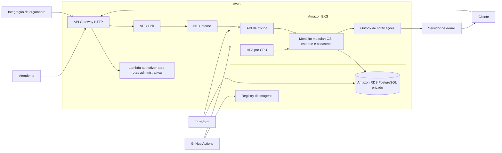

# Arquitetura proposta — fase 2

Este desenho representa o alvo planejado; os componentes AWS e a automação ainda precisam ser implementados e validados. A região, o tamanho e a disponibilidade dos recursos dependem do orçamento aprovado.

O Terraform provisiona rede, cluster e banco; a pipeline compila e testa a aplicação, publica sua imagem e aplica os manifestos no cluster. O banco deve permanecer privado. A comunicação com a integração e a configuração dos segredos requerem autenticação e transporte adequados. A estratégia de exposição da API, o serviço de e-mail e as opções de alta disponibilidade serão definidos junto ao dimensionamento e custo.

O HPA altera a quantidade de pods, condicionado às métricas e à capacidade dos nodes. EKS e RDS são serviços gerenciados, mas sua seleção isolada não comprova alta disponibilidade: réplicas, zonas, banco e recuperação devem ser configurados e testados.
