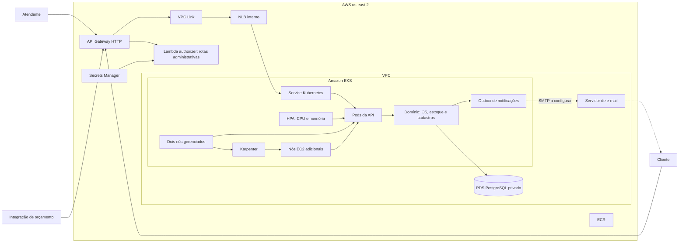
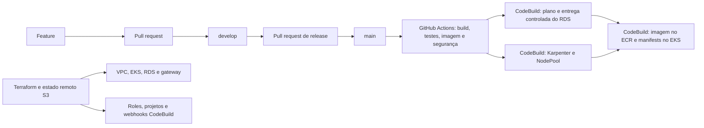

# Arquitetura — fase 2

O Garage Flow é um monólito modular com camadas de domínio, aplicação, infraestrutura e API. O ambiente de demonstração foi implantado na AWS em `us-east-2`, com EKS, RDS PostgreSQL privado e autenticação JWT. A infraestrutura é definida em [Terraform](../../infra/README.md); a configuração de nós elásticos e sua validação estão em [Karpenter](phase-2-karpenter.md).

O API Gateway expõe HTTPS; o authorizer verifica JWT para as rotas administrativas e as demais rotas continuam sujeitas às regras da aplicação. O caminho privado entre o gateway e a API usa HTTP. O RDS é Single-AZ e o NAT é único: esta configuração reduz custos, mas não representa alta disponibilidade completa. O envio real de notificações depende de SMTP configurado; a outbox mantém os eventos para processamento.

Os jobs AWS são habilitados por variáveis do repositório e usam ambientes protegidos limitados à `main`; o job do banco está sujeito à validação do plano descrita em [infra/README.md](../../infra/README.md). O Terraform de bootstrap é aplicado separadamente. O Flyway executa as migrações na inicialização da aplicação. Segredos da aplicação ficam fora do repositório, e as roles dos jobs são distintas. O HPA ajusta pods conforme métricas; o Karpenter adiciona ou consolida nós quando necessário. A arquitetura não implica custo zero: EKS, RDS, rede, instâncias e armazenamento podem consumir créditos mesmo sem tráfego.
